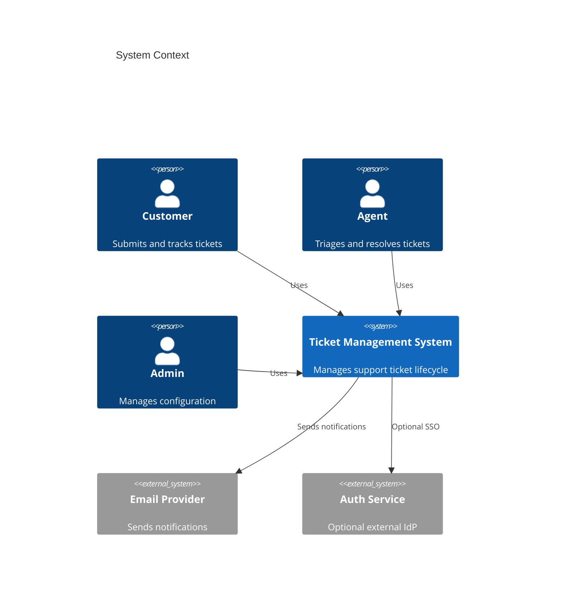
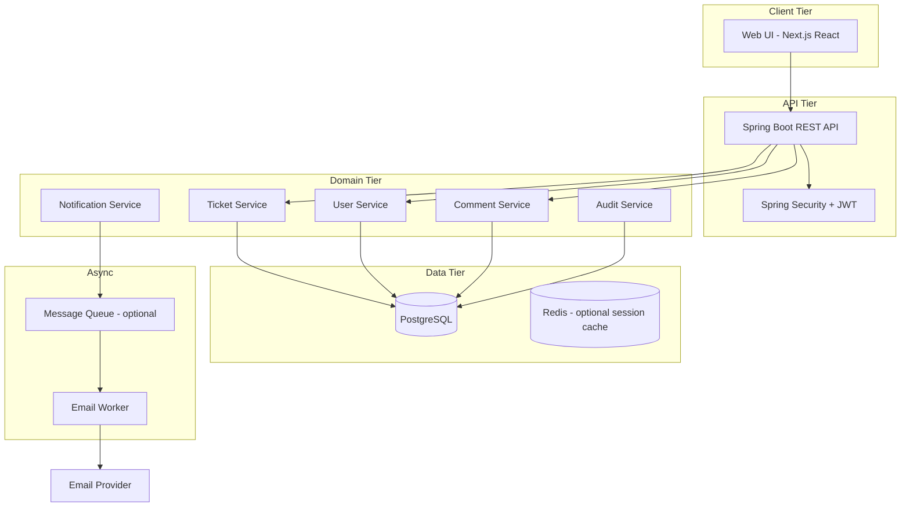

# Architecture

System architecture for the Support Ticket Management System.

## Context



## High-Level Components



## Technology Stack

| Layer | Technology | Rationale |
|-------|------------|-----------|
| API | Java 21, Spring Boot 3.x | Team expertise, mature ecosystem |
| Database | PostgreSQL 16 | ACID, JSON support, full-text search |
| Cache | Redis (optional v1) | Session/token blacklist if needed |
| Frontend | Next.js (React) + TypeScript | App Router, SSR/SSG, component ecosystem |
| Auth | JWT (stateless) | Scales horizontally |
| Migrations | Flyway | Version-controlled schema |
| Docs | OpenAPI 3.1 | Contract-first alignment with `api-contract.md` |

## Repository Layout (Monorepo)

Frontend and backend are sibling projects under one repository. Shared specifications and steering files live at the repo root.

```
support-ticket-management-system/
├── spec/                # Shared source of truth (requirements, API contract, etc.)
├── rules/               # Engineering standards for FE and BE
├── commands/            # Agent review/generation workflows
├── skills/              # Agent skills (documentation, etc.)
├── backend/             # Spring Boot REST API (Java 21, Gradle)
└── frontend/            # Next.js web application (TypeScript, App Router)
```

The frontend and backend communicate exclusively via REST (`/api/v1`) and JWT. They are built and deployed as separate artifacts.

### Local Development

```bash
# Terminal 1 — backend (port 8080)
cd backend && ./gradlew bootRun

# Terminal 2 — frontend (port 3000)
cd frontend && npm run dev
```

Optional: `docker compose up` at repo root starts PostgreSQL (and backend when configured).

## Backend Module Boundaries (Planned)

```
backend/
├── src/main/java/com/example/tickets/
│   ├── config/          # Security, CORS, OpenAPI
│   ├── domain/          # Entities, domain services, state machine
│   ├── repository/      # Spring Data repositories
│   ├── service/         # Business logic
│   └── web/             # REST controllers, DTOs, mappers
└── src/main/resources/db/migration/   # Flyway migrations
```

Start as a single Gradle project; split into subprojects when package boundaries stabilize.

## Frontend Structure (Planned)

```
frontend/
├── src/app/             # Next.js App Router pages and layouts
├── src/components/      # Reusable UI components
├── src/lib/             # API client, auth helpers, utilities
└── src/types/           # TypeScript types aligned with api-contract.md
```

## Key Design Decisions

### ADR-001: Monorepo with Separate Deployables

Keep frontend (`frontend/`) and backend (`backend/`) in one git repository with shared `spec/` at the root. Deploy as independent artifacts (static/SSR host for FE, JAR/container for BE). Do not embed the Next.js build inside Spring Boot static resources.

### ADR-002: Monolithic API (v1)

Deploy a single Spring Boot service. Extract notification worker first if email volume requires it.

### ADR-003: Optimistic Locking on Tickets

Use `@Version` on `Ticket` to prevent lost updates when multiple agents act concurrently.

### ADR-004: Event Log for Audit

Append-only `ticket_events` table records every status change, assignment, and priority change. Source for customer-visible history.

### ADR-005: Soft Delete

Tickets are never hard-deleted. `deleted_at` timestamp hides records from default queries.

## Security Architecture

- JWT issued at login; 1-hour access token, 7-day refresh token.
- Role checks at controller (`@PreAuthorize`) and service layer (defense in depth).
- Customers scoped to `customer_id = currentUser.id` on all ticket queries.
- Rate limiting on auth endpoints (10 req/min per IP).

## Deployment (Reference)

| Environment | Purpose |
|-------------|---------|
| dev | Local: `backend/` + `frontend/` processes; Docker Compose for PostgreSQL |
| staging | Pre-production validation |
| prod | HA PostgreSQL, 2+ API instances behind load balancer |

## Integration Points

| Integration | Direction | Protocol | Notes |
|-------------|-----------|----------|-------|
| Email | Outbound | SMTP / SendGrid API | Async, retry with backoff |
| Health check | Inbound | HTTP `/actuator/health` | Load balancer probe |

## Observability

- Structured JSON logging with `correlationId` per request.
- Metrics: request latency, error rate, tickets created/resolved per hour.
- Distributed tracing via OpenTelemetry (optional v1).

## Scalability Notes

- Stateless API instances scale horizontally.
- PostgreSQL read replicas for reporting queries (future).
- Full-text search via PostgreSQL `tsvector` initially; Elasticsearch if search demands grow.
