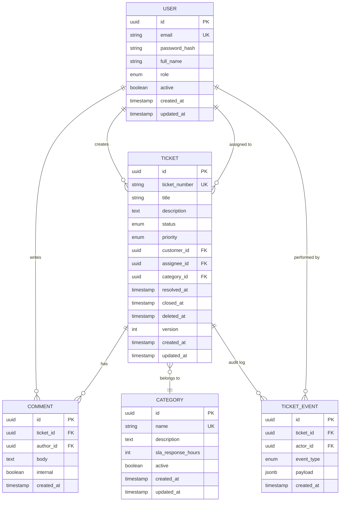

# Data Model

Entity definitions for the Support Ticket Management System.

## Entity Relationship Diagram



## Entities

### User

| Field | Type | Constraints | Description |
|-------|------|-------------|-------------|
| id | UUID | PK | Internal identifier |
| email | VARCHAR(255) | UNIQUE, NOT NULL | Login email |
| password_hash | VARCHAR(255) | NOT NULL | BCrypt hash |
| full_name | VARCHAR(200) | NOT NULL | Display name |
| role | ENUM | NOT NULL | CUSTOMER, AGENT, ADMIN |
| active | BOOLEAN | DEFAULT true | Soft deactivation |
| created_at | TIMESTAMPTZ | NOT NULL | |
| updated_at | TIMESTAMPTZ | NOT NULL | |

### Ticket

| Field | Type | Constraints | Description |
|-------|------|-------------|-------------|
| id | UUID | PK | Internal identifier |
| ticket_number | VARCHAR(20) | UNIQUE, NOT NULL | Human-readable ID (e.g., TKT-2026-00042) |
| title | VARCHAR(200) | NOT NULL | Short summary |
| description | TEXT | NOT NULL | Full problem description |
| status | ENUM | NOT NULL | See state-machine.md |
| priority | ENUM | NOT NULL | LOW, MEDIUM, HIGH, URGENT |
| customer_id | UUID | FK → user, NOT NULL | Ticket creator |
| assignee_id | UUID | FK → user, NULLABLE | Assigned agent |
| category_id | UUID | FK → category, NOT NULL | |
| resolved_at | TIMESTAMPTZ | NULLABLE | Set when status → RESOLVED |
| closed_at | TIMESTAMPTZ | NULLABLE | Set when status → CLOSED |
| deleted_at | TIMESTAMPTZ | NULLABLE | Soft delete |
| version | INTEGER | NOT NULL, DEFAULT 0 | Optimistic lock |
| created_at | TIMESTAMPTZ | NOT NULL | |
| updated_at | TIMESTAMPTZ | NOT NULL | |

### Comment

| Field | Type | Constraints | Description |
|-------|------|-------------|-------------|
| id | UUID | PK | |
| ticket_id | UUID | FK → ticket, NOT NULL | |
| author_id | UUID | FK → user, NOT NULL | |
| body | TEXT | NOT NULL, max 5000 chars | |
| internal | BOOLEAN | DEFAULT false | Hidden from customers |
| created_at | TIMESTAMPTZ | NOT NULL | Immutable after creation |

### Category

| Field | Type | Constraints | Description |
|-------|------|-------------|-------------|
| id | UUID | PK | |
| name | VARCHAR(100) | UNIQUE, NOT NULL | e.g., "Billing", "Technical" |
| description | TEXT | NULLABLE | |
| sla_response_hours | INTEGER | NULLABLE | First-response SLA |
| active | BOOLEAN | DEFAULT true | |
| created_at | TIMESTAMPTZ | NOT NULL | |
| updated_at | TIMESTAMPTZ | NOT NULL | |

### TicketEvent (Audit Log)

| Field | Type | Constraints | Description |
|-------|------|-------------|-------------|
| id | UUID | PK | |
| ticket_id | UUID | FK → ticket, NOT NULL | |
| actor_id | UUID | FK → user, NOT NULL | Who performed the action |
| event_type | ENUM | NOT NULL | CREATED, STATUS_CHANGED, ASSIGNED, PRIORITY_CHANGED, COMMENT_ADDED |
| payload | JSONB | NOT NULL | Event-specific details |
| created_at | TIMESTAMPTZ | NOT NULL | Immutable |

#### Event Payload Examples

```json
// STATUS_CHANGED
{ "from": "OPEN", "to": "IN_PROGRESS" }

// ASSIGNED
{ "fromAssigneeId": null, "toAssigneeId": "uuid-here" }

// PRIORITY_CHANGED
{ "from": "MEDIUM", "to": "HIGH" }
```

## Enumerations

### TicketStatus

`OPEN` | `IN_PROGRESS` | `WAITING_ON_CUSTOMER` | `RESOLVED` | `CLOSED` | `REOPENED`

### TicketPriority

`LOW` | `MEDIUM` | `HIGH` | `URGENT`

### UserRole

`CUSTOMER` | `AGENT` | `ADMIN`

### TicketEventType

`CREATED` | `STATUS_CHANGED` | `ASSIGNED` | `PRIORITY_CHANGED` | `COMMENT_ADDED`

## Indexes

| Table | Index | Purpose |
|-------|-------|---------|
| ticket | (status, created_at DESC) | Agent queue |
| ticket | (customer_id, created_at DESC) | Customer ticket list |
| ticket | (assignee_id, status) | Agent workload |
| ticket | (ticket_number) | Lookup by number |
| ticket | GIN(to_tsvector('english', title \|\| ' ' \|\| description)) | Full-text search |
| comment | (ticket_id, created_at) | Comment thread |
| ticket_event | (ticket_id, created_at) | Audit history |

## Ticket Number Generation

Format: `TKT-{YEAR}-{SEQUENCE}` (e.g., `TKT-2026-00042`).

- Sequence resets annually.
- Generated in a database transaction to guarantee uniqueness.

## Data Integrity Rules

1. `assignee_id` must reference a user with role AGENT or ADMIN.
2. `customer_id` must reference a user with role CUSTOMER.
3. Comments on `CLOSED` tickets are rejected (REQ-012).
4. `internal = true` comments excluded from customer API responses.
5. Deactivated categories (`active = false`) cannot be assigned to new tickets.
