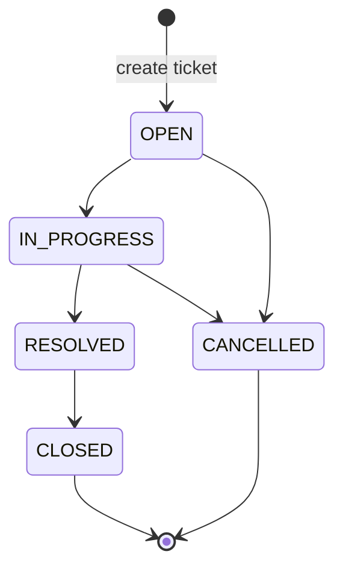

# State Machine

Ticket status transitions enforced by the backend.

## States

| State | Description | Terminal |
|-------|-------------|----------|
| OPEN | Newly created | No |
| IN_PROGRESS | Work has started | No |
| RESOLVED | Fix is ready to close | No |
| CLOSED | Finished | Yes |
| CANCELLED | Withdrawn before resolution | Yes |

## Allowed transitions

| From | To | Allowed |
|------|----|---------|
| OPEN | IN_PROGRESS | Yes |
| OPEN | CANCELLED | Yes |
| IN_PROGRESS | RESOLVED | Yes |
| IN_PROGRESS | CANCELLED | Yes |
| RESOLVED | CLOSED | Yes |
| CLOSED | OPEN | No |
| RESOLVED | OPEN | No |
| CANCELLED | OPEN | No |
| Any other pair | | No |

## Rules

1. New tickets are created in `OPEN`.
2. Status changes go through `POST /api/v1/tickets/{id}/transitions`.
3. Field updates (`title`, `description`, `priority`, `assignee`) do not change status.
4. An invalid transition returns `409 Conflict` with detail `Cannot transition from {FROM} to {TO}.`
5. Ticket responses include `allowedTransitions` for the current status.

## Tests

`TicketStateMachineIT` covers the happy path, cancellation, and the rejected transitions above.
