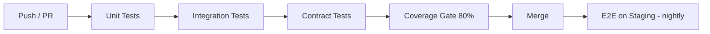

# Test Strategy

Testing approach for the Support Ticket Management System.

## Objectives

1. Verify all requirements in `requirements.md` are met.
2. Enforce state machine rules in `state-machine.md` with exhaustive transition tests.
3. Validate API contract in `api-contract.md` via automated contract tests.
4. Cover critical UI flows in `ui-flow.md` with e2e smoke tests.
5. Maintain fast feedback: unit tests < 30s, full suite < 5 min.

## Test Levels

### 1. Unit Tests

**Scope**: Domain logic, state machine, mappers, validators, utilities.

| Component | Key Scenarios |
|-----------|---------------|
| TicketStateMachine | All allowed/denied transitions per role |
| TicketService | Create, assign, filter, authorization scoping |
| TicketNumberGenerator | Uniqueness, format, year rollover |
| CommentService | Internal flag filtering, closed ticket rejection |
| UserService | Registration validation, role checks |

**Tools**: JUnit 5, Mockito, AssertJ.

### 2. Integration Tests

**Scope**: Repositories, controllers with real database, security filters.

| Area | Approach |
|------|----------|
| Repositories | Testcontainers PostgreSQL, verify queries and indexes |
| Controllers | `@SpringBootTest` + MockMvc, JWT test tokens |
| Security | Role-based access per endpoint |
| Migrations | Flyway migrations apply cleanly on empty DB |

**Tools**: Spring Boot Test, Testcontainers, MockMvc.

### 3. Contract Tests

**Scope**: API shape, status codes, error format against `api-contract.md`.

- One test class per resource (`TicketControllerContractTest`).
- JSON schema validation or strict field assertions.
- Problem Details structure on all error responses.

### 4. End-to-End Tests (Smoke)

**Scope**: Critical paths from `ui-flow.md`.

| Flow ID | Scenario | Priority |
|---------|----------|----------|
| CF-002 | Customer creates ticket | P0 |
| AF-002 | Agent resolves ticket | P0 |
| CF-004 | Customer reopens within window | P1 |
| ADF-001 | Admin manages categories | P2 |

**Tools**: Playwright or Cypress against staging environment.

## Requirements Traceability

| Requirement | Test Level | Test IDs |
|-------------|------------|----------|
| REQ-001 | Unit + Contract | TC-U-001, TC-C-001 |
| REQ-003 | Unit | TC-U-002 |
| REQ-005 | Integration | TC-I-003 |
| REQ-006 | Unit | TC-U-010 – TC-U-050 (state machine) |
| REQ-007 | Integration | TC-I-005 |
| REQ-008 | Contract | TC-C-010 |
| REQ-009 | Unit | TC-U-020 |
| REQ-012 | Unit + Contract | TC-U-021, TC-C-011 |
| REQ-040 | Integration | TC-I-010 |
| REQ-050 | Integration (mock SMTP) | TC-I-020 |
| NFR-005 | Integration | TC-I-030 |

## State Machine Test Matrix

Parameterized test covering every `(from, to, role)` combination:

```
@ParameterizedTest
@CsvSource({
  "OPEN, IN_PROGRESS, AGENT, true",
  "OPEN, IN_PROGRESS, CUSTOMER, false",
  "RESOLVED, REOPENED, CUSTOMER, true",
  "RESOLVED, REOPENED, CUSTOMER_AFTER_7_DAYS, false",
  "CLOSED, OPEN, ADMIN, false",
  ...
})
void shouldValidateTransition(from, to, role, allowed) { ... }
```

## Test Data Strategy

### Fixtures

```
src/test/java/.../fixtures/
├── UserTestFactory.java
├── TicketTestFactory.java
├── CategoryTestFactory.java
└── JwtTestHelper.java
```

### Database Seeding

- Integration tests: minimal seed (1 admin, 2 agents, 2 customers, 3 categories).
- Per-test isolation via `@Transactional` rollback or `@Sql` cleanup.

## Security Test Cases

| ID | Scenario | Expected |
|----|----------|----------|
| SEC-001 | Customer accesses another customer's ticket | 403 |
| SEC-002 | Unauthenticated API call | 401 |
| SEC-003 | Customer calls assign endpoint | 403 |
| SEC-004 | SQL injection in search query | Safe handling, no error leak |
| SEC-005 | Expired JWT | 401 |

## Performance Tests (Future)

- Load test: 500 concurrent users creating and listing tickets.
- Target: p95 < 300ms read, < 500ms write (NFR-001).
- Tool: k6 or Gatling.

## CI Pipeline



## Coverage Policy

| Package | Minimum |
|---------|---------|
| service | 80% |
| domain (state machine) | 100% |
| web/controller | 70% |
| repository | 60% (integration tests compensate) |

## Test Environments

| Env | Purpose | Data |
|-----|---------|------|
| Local | Developer runs `./gradlew check` | Testcontainers |
| CI | GitHub Actions / Jenkins | Ephemeral PostgreSQL |
| Staging | E2E smoke | Anonymized seed data |
| Prod | Synthetic health checks only | No test data |

## Defect Severity Mapping

| Severity | Criteria | Blocks Release |
|----------|----------|----------------|
| P0 | Data loss, security breach, state machine bypass | Yes |
| P1 | Core flow broken (create, resolve, login) | Yes |
| P2 | Secondary feature broken | No |
| P3 | Cosmetic | No |

## Reporting

- CI publishes JUnit XML and coverage report (JaCoCo).
- Failed tests block merge.
- Weekly test health review: flaky test count, coverage trend, untested requirements.
