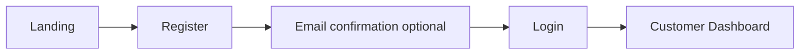
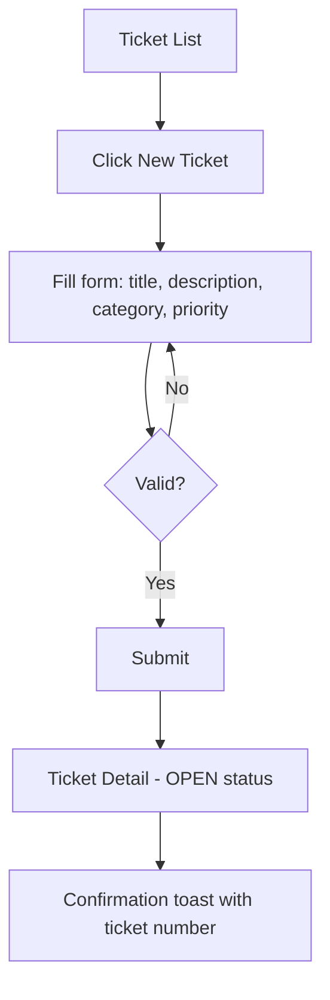
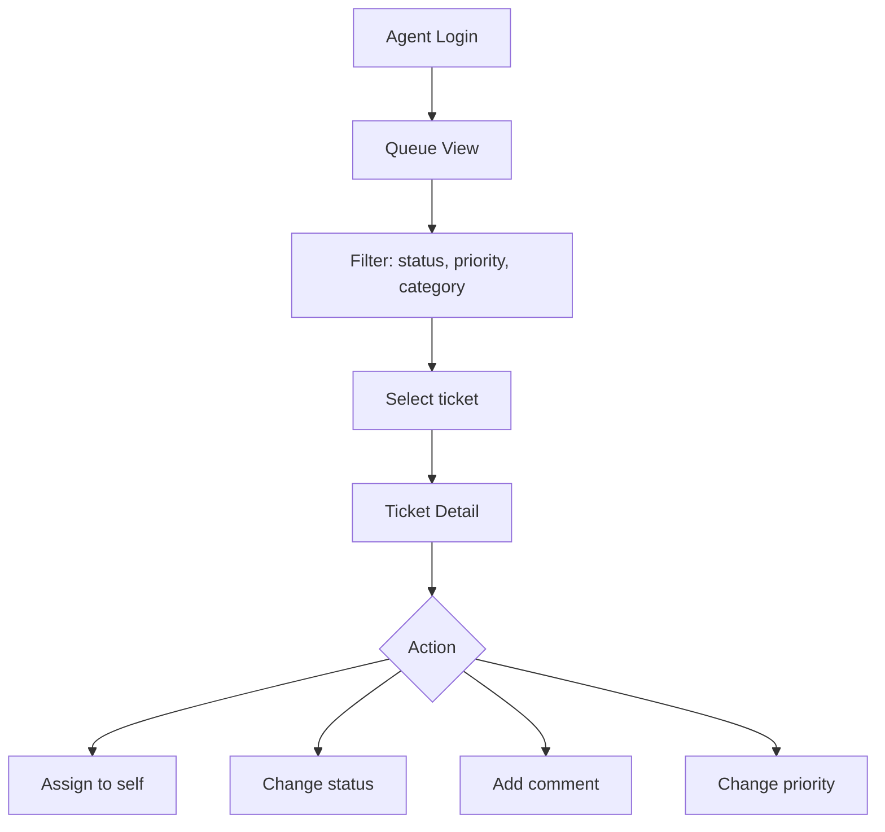

# UI Flow

User interface flows for the Support Ticket Management System.

## Application Structure

```
/                     → Landing / redirect by role
/login                → Authentication
/register             → Customer registration
/customer/tickets     → Customer ticket list
/customer/tickets/new → Create ticket
/customer/tickets/:id → Ticket detail
/agent/queue          → Agent ticket queue
/agent/tickets/:id    → Agent ticket detail
/admin/users          → User management
/admin/categories     → Category management
/admin/reports        → Dashboard
```

## Customer Flows

### CF-001: Register and Login



**Steps**
1. Customer visits `/register`, enters email, password, full name.
2. System creates account with role CUSTOMER.
3. Customer logs in at `/login`.
4. Redirect to `/customer/tickets`.

### CF-002: Create Ticket



**Form Fields**

| Field | Required | Validation |
|-------|----------|------------|
| Title | Yes | 1–200 characters |
| Description | Yes | 1–10000 characters |
| Category | Yes | Active category dropdown |
| Priority | Yes | Default MEDIUM |

**API**: `POST /api/v1/tickets`

### CF-003: Track Ticket

1. Customer opens `/customer/tickets`.
2. List shows ticket number, title, status, priority, updated date.
3. Filter by status (dropdown).
4. Click row → `/customer/tickets/:id`.
5. Detail view shows: header (number, status badge), description, comment thread, timeline (history).
6. Customer adds comment via text area + Submit.
7. If status is RESOLVED, show "Confirm Resolution" and "Reopen" buttons.

**API**: `GET /tickets`, `GET /tickets/{id}`, `POST /tickets/{id}/comments`, `POST /tickets/{id}/transitions`

### CF-004: Reopen Ticket

1. On RESOLVED ticket, customer clicks "Reopen".
2. Modal asks for reason (optional text → added as comment).
3. Confirm → status becomes REOPENED.
4. Disabled if resolved more than 7 days ago (show explanation).

---

## Agent Flows

### AF-001: Triage Queue



**Queue Columns**: Ticket #, Title, Status, Priority, Category, Customer, Assignee, Created, Updated

**Default filter**: status IN (OPEN, REOPENED) OR assignee = me

**API**: `GET /tickets?status=OPEN&...`, `POST /tickets/{id}/assign`

### AF-002: Work Ticket

1. Agent opens ticket from queue.
2. Clicks "Start Working" → OPEN/REOPENED → IN_PROGRESS (auto-assign).
3. Adds internal note (checkbox "Internal only").
4. If needs customer input → "Waiting on Customer".
5. When fixed → "Mark Resolved" with optional resolution summary comment.
6. Status badge and timeline update in real time (polling or WebSocket future).

### AF-003: Assign to Colleague

1. Agent opens assignee dropdown on ticket detail.
2. Selects agent from active agent list.
3. System calls `POST /tickets/{id}/assign`.
4. Toast confirms assignment; assignee column updates.

---

## Admin Flows

### ADF-001: Manage Categories

1. Admin navigates to `/admin/categories`.
2. Table: Name, SLA Hours, Active, Actions.
3. "Add Category" opens modal.
4. Edit inline or via modal; deactivate toggles `active` flag.
5. Deactivated categories grayed out, not in customer dropdown.

**API**: `GET /categories`, `POST /categories`, `PATCH /categories/{id}`

### ADF-002: Manage Users

1. Admin navigates to `/admin/users`.
2. Filter by role and active status.
3. "Create Agent" form: email, name, temporary password.
4. Deactivate user → `active = false`; cannot log in.

**API**: `GET /users`, `POST /users`, `PATCH /users/{id}`

### ADF-003: Reports Dashboard

1. Admin navigates to `/admin/reports`.
2. Date range picker (default: last 30 days).
3. Charts: tickets by status (pie), tickets by category (bar).
4. Export CSV (future).

**API**: `GET /reports/ticket-summary`

---

## Shared UI Components

| Component | Usage |
|-----------|-------|
| StatusBadge | Color-coded ticket status |
| PriorityBadge | LOW (gray), MEDIUM (blue), HIGH (orange), URGENT (red) |
| CommentThread | Chronological comments with author avatar |
| TicketTimeline | Audit events from history endpoint |
| Pagination | List views |
| ConfirmModal | Destructive actions (close, deactivate) |

## Responsive Behavior

- Desktop: side navigation + content area.
- Tablet: collapsible navigation.
- Mobile: bottom tab bar for customers (Tickets, New, Profile).

## Error States

| Scenario | UI Behavior |
|----------|-------------|
| 401 Unauthorized | Redirect to login |
| 403 Forbidden | "You don't have access" page |
| 404 Not Found | "Ticket not found" with back link |
| 409 Conflict | Inline error on action (e.g., invalid transition) |
| Network error | Retry banner with exponential backoff |

## Accessibility

- All form fields have associated labels.
- Status changes announced via ARIA live regions.
- Keyboard navigable: tab order, Enter to submit, Escape to close modals.
- Color is not the only indicator for status (icons + text).
